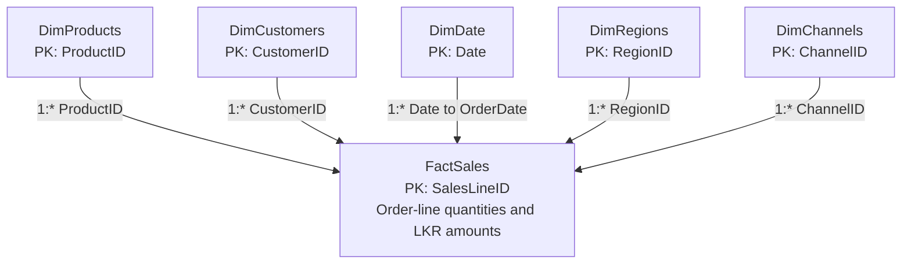

# Retail Sales Analytics — Data Model

This document defines the intended star schema. Load the five CSV queries using
the [Power Query setup guide](power_query_setup.md) before following the manual
Desktop steps below. No model, DAX table, relationships, or report have been
created or verified in Power BI Desktop for this step.

## Tables and grain

FactSales sits at the center. Dimensions provide the labels used in slicers,
axes, and grouping; FactSales provides the quantities and LKR amounts.

| Table | One row represents | Primary key | Source |
| --- | --- | --- | --- |
| FactSales | One product line within an order | SalesLineID | `data/raw/fact_sales.csv`, cleaned by `fact_sales.m` |
| DimProducts | One product | ProductID | `data/raw/dim_products.csv` |
| DimCustomers | One synthetic customer | CustomerID | `data/raw/dim_customers.csv` |
| DimRegions | One sales region (Sri Lankan province) | RegionID | `data/raw/dim_regions.csv` |
| DimChannels | One sales channel | ChannelID | `data/raw/dim_channels.csv` |
| DimDate | One calendar day, including days without sales | Date | DAX calculated table defined below |

An order can have several FactSales rows. OrderID is an order grouping label,
not the fact primary key. Count distinct OrderID values for order counts.
FactSales contains the Power Query columns GrossSales, NetSales, TotalCost, and
LineProfit. NetSales is revenue after the line discount; LineProfit is NetSales
minus TotalCost. Do not subtract discounts again when using NetSales.
See the [data dictionary](data_dictionary.md) for column definitions.

## Relationship diagram

Each arrow points in the filter direction: dimension to fact. Every edge is
one-to-many (`1:*`); a dimension row may have zero or many matching sales lines.



## Relationship settings

Create exactly these five **active** relationships. Join using equality on the
listed keys. Every dimension key must be unique and nonblank; fact foreign keys
may repeat and must match a dimension row.

| One side (dimension) | Many side (fact) | Key type on both sides | Cardinality | Cross-filter direction |
| --- | --- | --- | --- | --- |
| DimProducts[ProductID] | FactSales[ProductID] | Text | One-to-many (1:*) | Single: DimProducts → FactSales |
| DimCustomers[CustomerID] | FactSales[CustomerID] | Text | One-to-many (1:*) | Single: DimCustomers → FactSales |
| DimRegions[RegionID] | FactSales[RegionID] | Text | One-to-many (1:*) | Single: DimRegions → FactSales |
| DimChannels[ChannelID] | FactSales[ChannelID] | Text | One-to-many (1:*) | Single: DimChannels → FactSales |
| DimDate[Date] | FactSales[OrderDate] | Date | One-to-many (1:*) | Single: DimDate → FactSales |

For example, choosing Western in DimRegions filters the matching FactSales rows.
Single-direction filtering does not make a fact selection filter back into the
dimensions. This keeps each dimension's route to FactSales clear; Microsoft also
recommends limiting bidirectional relationships in its
[relationship guidance](https://learn.microsoft.com/en-us/power-bi/guidance/relationships-bidirectional-filtering).

DimCustomers includes RegionID for source reference and cleaning checks. Keep
that column, but do not create a relationship between DimRegions and DimCustomers.
Region filtering reaches FactSales through its own RegionID relationship. The
Power Query joins validate keys without creating model relationships.

## Create the contiguous DimDate table

Sales cover **2025-01-01 through 2026-09-30**. DimDate covers **2025-01-01 through
2026-12-31**, giving 730 daily rows and complete calendar years. It includes days
with no sales. October–December 2026 dates do not imply additional sales records.
Using full years follows Microsoft's
[date-table design guidance](https://learn.microsoft.com/en-us/power-bi/guidance/model-date-tables).

1. In Desktop, finish **Close & Apply** after loading the five Power Query tables.
2. Select **Modeling → New table**. This creates a calculated table, not a measure
   or a Power Query query.
3. Replace the formula bar contents with this entire expression and press Enter.
   If DimDate already exists, update its expression instead of creating a duplicate.

```dax
DimDate =
VAR StartDate = DATE ( 2025, 1, 1 )
VAR EndDate = DATE ( 2026, 12, 31 )
RETURN
    ADDCOLUMNS (
        CALENDAR ( StartDate, EndDate ),
        "Year", YEAR ( [Date] ),
        "Quarter", "Q" & FORMAT ( QUARTER ( [Date] ), "0" ),
        "MonthNumber", MONTH ( [Date] ),
        "MonthName", FORMAT ( [Date], "MMMM", "en-US" ),
        "YearMonth", FORMAT ( [Date], "yyyy-MM", "en-US" ),
        "YearMonthSort", YEAR ( [Date] ) * 100 + MONTH ( [Date] )
    )
```

`CALENDAR` supplies the Date column and every date between the endpoints,
inclusive. See [the CALENDAR reference](https://learn.microsoft.com/en-us/dax/calendar-function-dax).
The explicit English locale keeps month labels in simple English. These bounds
are deliberate for this dataset; extend them to full calendar years if future
data expands the project period.

| Column | Model data type | Example / purpose |
| --- | --- | --- |
| Date | Date | `2025-01-01`; unique date key |
| Year | Whole Number | `2025`; calendar year |
| Quarter | Text | `Q1`; use within Year to distinguish years |
| MonthNumber | Whole Number | `1` to `12`; month sorting key |
| MonthName | Text | `January`; readable month label |
| YearMonth | Text | `2025-01`; monthly label that distinguishes years |
| YearMonthSort | Whole Number | `202501`; chronological monthly sorting key |

## Mark DimDate as the Date table

1. Expand DimDate in Desktop's Data pane and select its **Date** column.
   On **Column tools**, set **Data type → Date**. Confirm FactSales[OrderDate]
   also uses Date, with no time component.
2. Right-click **DimDate** in the Data pane and select
   **Mark as date table → Mark as date table**. You can also select the table
   and use **Table tools → Mark as date table**.
3. Select **Date** as the date column and confirm with **OK** or **Save**.
   If your version groups this setting under **Calendar options**, open that
   menu to find **Mark as date table**.

The Date key must have unique values, no blanks, and no gaps. Marking the table
supports the classic date-column time-intelligence functions planned in the
project. Microsoft's [date-table setup guide](https://learn.microsoft.com/en-us/power-bi/transform-model/desktop-date-tables)
describes the setting and validation. Use DimDate fields in date slicers and
visuals rather than an automatic hierarchy on FactSales[OrderDate].

## Sort month labels

1. Switch to **Report view** and expand DimDate in the Data pane.
2. Select **MonthName**, then choose **Column tools → Sort by column → MonthNumber**.
3. Select **YearMonth**, then choose **Column tools → Sort by column → YearMonthSort**.
4. For a monthly visual, choose ascending sorting by the date label rather than
   sorting by a revenue value.

MonthName then runs January through December. Use YearMonth for trends spanning
both years so January 2025 and January 2026 remain separate. Each MonthName has
one MonthNumber, and each YearMonth has one YearMonthSort; this is required for
[sorting one column by another](https://learn.microsoft.com/en-us/power-bi/create-reports/desktop-sort-by-column).
Keep MonthNumber and YearMonthSort in the model even if you hide them from report
view after configuring sorting.

## Create relationships manually in Desktop

1. Open **Model view** and place FactSales in the center with the five dimensions
   around it, following the diagram.
2. Open **Manage relationships**. Review any automatically detected relationships;
   remove links between dimensions and correct any settings that differ from
   the five-row relationship table above.
3. For each missing link, select **New**, choose the dimension and its key as the
   first table/column, and FactSales with its matching key as the second.
4. Set **Cardinality → One to many (1:*)**, **Cross-filter direction → Single**,
   and **Make this relationship active**. Confirm and repeat for all five links.
5. Check that each dimension displays `1` and FactSales displays `*`, with arrows
   pointing toward FactSales. Save the actual report in `powerbi/`.

The quick expected check is five active links and 730 DimDate rows spanning
2025-01-01 through 2026-12-31. Report filters for the actual sales period should
end at 2026-09-30 when comparing available sales; 2026 is a partial sales year.
These are instructions and expected results. Desktop execution and verification
remain pending.
